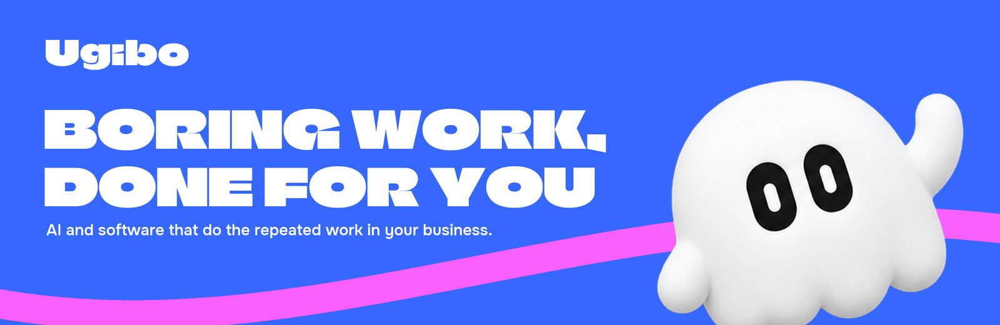
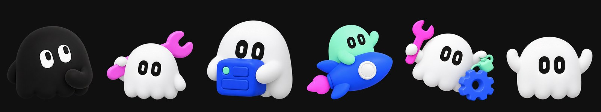
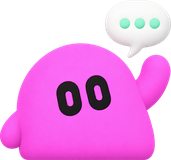

<p align="center"></p>

# Ugibo/.github

The Ugibo organisation profile, and the community files every Ugibo repository falls back on.
The profile is what you see at **[github.com/Ugibo](https://github.com/Ugibo)**.

<p align="center"></p>

## What is in here

| | Where | What it does |
| --- | --- | --- |
| :wave: | [`profile/README.md`](profile/README.md) | The org's front page on GitHub. |
| :art: | [`profile/assets/`](profile/assets) | The banner, the Boo lineup and the footer Boo. |
| :shield: | [`SECURITY.md`](SECURITY.md) | How to report a security problem privately. |
| :handshake: | [`CONTRIBUTING.md`](CONTRIBUTING.md) | How to send a change to a public repository. |
| :heart: | [`CODE_OF_CONDUCT.md`](CODE_OF_CONDUCT.md) | How we treat each other. |
| :bug: | [`ISSUE_TEMPLATE/`](ISSUE_TEMPLATE) | Bug and idea forms; blank issues are off. |
| :white_check_mark: | [`pull_request_template.md`](pull_request_template.md) | The checklist on every pull request. |

Any repository that has no `SECURITY.md`, `CONTRIBUTING.md`, code of conduct, issue forms or
pull request template of its own uses these.

## The art

Nobody draws these by hand. `assets/make-readme-art.py` in the brand repository makes every
Ugibo README banner from the brand fonts, colours and Boo renders:

```bash
uv run --no-project --with pillow python assets/make-readme-art.py
```

<p align="center">
  
  
  
  
  <br><sub><code>#3667FF</code> blue &nbsp; <code>#F95FFF</code> pink &nbsp; <code>#94FFD1</code> mint &nbsp; <code>#101010</code> ink</sub>
</p>

---

<p align="center"><br><sub>Loud colour, plain words, nothing over the text.</sub></p>
