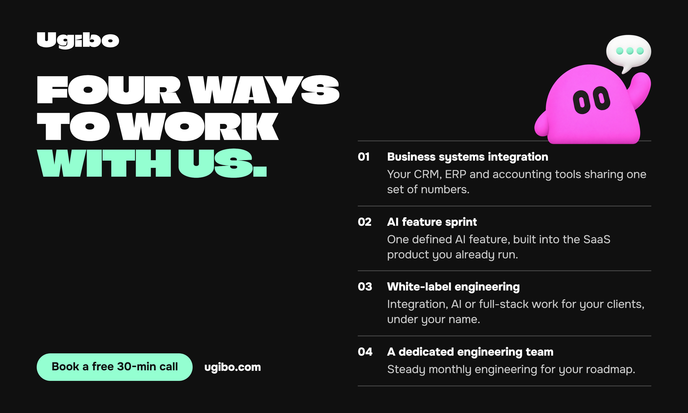

<p align="center"></p>

<p align="center">
  <a href="https://ugibo.com"><b>ugibo.com</b></a> &nbsp;&middot;&nbsp;
  <a href="mailto:team@ugibo.com"><b>team@ugibo.com</b></a> &nbsp;&middot;&nbsp;
  <a href="https://github.com/Ugibo/mcp"><b>Ugibo/mcp</b></a>
</p>

# Hi, we are Ugibo

We build software and AI for businesses, software companies and agencies: the systems that
take repeated work off a team, and the features a product team has no time to build. We
build on the tools you already use, the first piece is working in weeks, and we look after
it afterwards.

<p align="center"></p>

## Open source

**[`Ugibo/mcp`](https://github.com/Ugibo/mcp)**: your Ugibo projects, tasks, requests and team
memory inside Claude Code, Cursor, VS Code and any editor that speaks MCP.

```bash
uvx --from "git+https://github.com/Ugibo/mcp" ugibo-mcp
```

## Say hello

Want something built? Write to [team@ugibo.com](mailto:team@ugibo.com) or book a free 30-min
call at [ugibo.com](https://ugibo.com). Found a bug in a public repository? Open an issue
there. Found a security problem? Read the
[security policy](https://github.com/Ugibo/.github/blob/main/SECURITY.md) and tell us
privately first.
